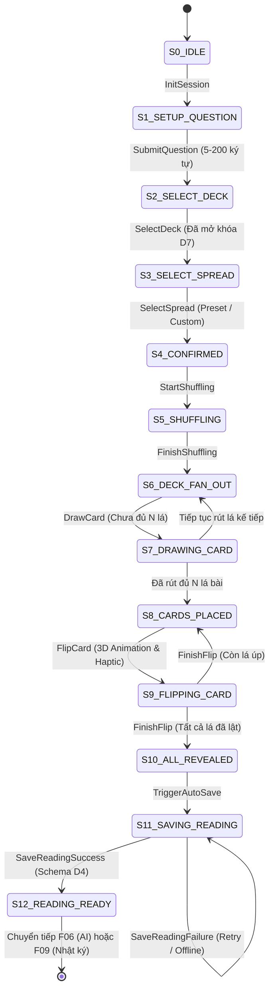

# Đặc tả Mô hình Kiểu trải bài & Máy trạng thái F04 (KI-09 · RR05)

- **Mã Task:** `KI-09`
- **Tên Task:** Mô hình kiểu trải; liệt kê trạng thái và chuyển trạng thái của F04 (RR05)
- **Chức năng:** `F04` – Trải bài theo gói và tùy chỉnh (Gói 2 – Phiên trải bài và AI)
- **Người thực hiện:** Kiên (Nguyễn Đình Trung Kiên) – PM / Lead Gói 2
- **Người review:** Uyên (Nguyễn Thanh Hạ Uyên) – QA / Release Lead (Gói 1)
- **Thời lượng:** 4 giờ công (hạn 20/11/2026, đợt review Chủ nhật 22/11/2026 theo R22)
- **Rủi ro đối ứng:** **RR05** (Doc chính Tab 4.3): *"F04 có nhiều trạng thái, dễ rối. Phương án dự phòng: Liệt kê trạng thái và chuyển trạng thái trước khi code; test từng trạng thái"*.
- **Vị trí mã nguồn liên quan:**
  - `app/src/main/java/com/taroshimaya/app/features/session_ai/domain/SpreadModels.kt`
  - `app/src/main/java/com/taroshimaya/app/features/session_ai/domain/F04SessionState.kt`
  - `app/src/test/java/com/taroshimaya/app/features/session_ai/F04StateMachineTest.kt`

---

## 1. Bối cảnh & Mục tiêu Kiến trúc

Chức năng **F04** là hạt nhân của toàn bộ ứng dụng Taroshimaya, kết nối luồng trải nghiệm đa giác quan (chọn bài, xáo bài 78 lá mẫu, rút bài, lật 3D kèm Haptic) và dữ liệu phiên trải bài lưu trữ trên Firestore (`readings` theo hợp đồng **D4**), đồng thời cung cấp Composable bàn trải bài (**D6**) cho Gói 4 (Tân) tái sử dụng cho phòng trải bài trực tuyến F19.

Tài liệu này giải quyết triệt để 2 bài toán nền tảng:
1. **Mô hình hóa dữ liệu kiểu trải bài (Spread Models)**: Chuẩn hóa 5 gói trải bài cố định theo chuyên đề và cơ chế trải bài tự do 1, 3, 5 lá, hỗ trợ tọa độ hiển thị chuẩn hóa (Normalized Layout Coordinates) trên màn hình.
2. **Máy trạng thái hữu hạn (Finite State Machine - FSM)**: Phân tách rõ ràng 12 trạng thái vòng đời, 5 trạng thái lỗi/biên, và ma trận chuyển trạng thái kèm các điều kiện bảo vệ (Guards), bảo đảm giao diện Jetpack Compose tuân thủ chặt chẽ mô hình Unidirectional Data Flow (UDF), không bị lỗi race condition hay re-composition phân mảnh.

---

## 2. Mô hình Kiểu trải bài (Spread Models Architecture)

### 2.1. Năm gói trải bài chuyên sâu cố định (Preset Spreads)

| Mã sơ đồ (`id`) | Tên kiểu trải (VI / EN) | Số lá | Ý nghĩa từng vị trí |
| :--- | :--- | :---: | :--- |
| `spread_love_3` | **Tình yêu**<br>*Love & Relationship* | 3 | **0:** Bạn (Năng lượng cá nhân)<br>**1:** Đối phương (Năng lượng đối xứng)<br>**2:** Xu hướng kết nối |
| `spread_career_3` | **Sự nghiệp**<br>*Career & Professional* | 3 | **0:** Hiện trạng công việc<br>**1:** Thử thách & Trở ngại<br>**2:** Giải pháp & Tiềm năng |
| `spread_finance_3` | **Tài chính**<br>*Finance & Wealth* | 3 | **0:** Nguồn lực & Thu nhập<br>**1:** Thất thoát & Rủi ro<br>**2:** Chiến lược tối ưu |
| `spread_healing_3` | **Chữa lành**<br>*Mindfulness & Healing* | 3 | **0:** Tổn thương tiềm thức<br>**1:** Bài học nhận thức<br>**2:** Năng lượng chuyển hóa |
| `spread_yes_no_1` | **Quyết định nhanh Yes/No**<br>*Quick Yes/No Decision* | 1 | **0:** Câu trả lời & Hướng đi trực tiếp |
| `spread_decision_3`| **Quyết định đa chiều**<br>*Comprehensive Decision* | 3 | **0:** Điểm thuận (Yes)<br>**1:** Điểm cản (No)<br>**2:** Kết luận xu hướng |

### 2.2. Kiểu trải tùy chỉnh tự do (Custom Spreads: 1, 3, 5 lá)

Hệ thống cho phép người dùng tự cấu hình số lượng lá và ý nghĩa của từng vị trí thông qua hàm khởi tạo `PresetSpreads.createCustomSpread(cardCount, customLabelsVi, customLabelsEn)`:
- **1 lá (`cardCount = 1`)**: Trọng tâm vấn đề duy nhất.
- **3 lá (`cardCount = 3`)**: Phân tích 3 yếu tố linh hoạt (Quá khứ / Hiện tại / Hướng đi hoặc Ba nhân tố tự đặt).
- **5 lá (`cardCount = 5`)**: Bố cục chữ thập mở rộng:
  - Vị trí 0: Thực trạng trung tâm $(X: 0.5, Y: 0.5)$.
  - Vị trí 1: Nguồn gốc quá khứ $(X: 0.2, Y: 0.5)$.
  - Vị trí 2: Kỳ vọng tương lai $(X: 0.8, Y: 0.5)$.
  - Vị trí 3: Tiềm thức & Nỗi sợ $(X: 0.5, Y: 0.2)$.
  - Vị trí 4: Lời khuyên tối hậu $(X: 0.5, Y: 0.8)$.

### 2.3. Hợp đồng Dữ liệu Kotlin (Data Contracts)

```kotlin
data class SpreadPosition(
    val index: Int,
    val nameVi: String,
    val nameEn: String,
    val descriptionVi: String,
    val descriptionEn: String,
    val normalizedX: Float, // 0.0f .. 1.0f trên Canvas bàn trải bài D6
    val normalizedY: Float, // 0.0f .. 1.0f
    val rotationDegrees: Float = 0f,
)

data class SpreadConfig(
    val id: String,
    val category: SpreadCategory,
    val cardCount: Int,
    val titleVi: String,
    val titleEn: String,
    val descriptionVi: String,
    val descriptionEn: String,
    val positions: List<SpreadPosition>,
    val isCustom: Boolean = false,
)

data class PlacedCard(
    val positionIndex: Int,
    val cardId: String, // Khớp format D2: major_00_fool..minor_pentacles_14_king
    val orientation: CardOrientation = CardOrientation.UPRIGHT,
    val isRevealed: Boolean = false,
    val revealedAtUtc: Long? = null,
)
```

---

## 3. Máy trạng thái hữu hạn F04 (F04 Finite State Machine · RR05)

### 3.1. Danh sách 12 Trạng thái Vòng đời (Lifecycle States)

1. `S0_IDLE`: Khởi tạo phiên, chưa có câu hỏi hay lựa chọn nào.
2. `S1_SETUP_QUESTION`: Người dùng nhập câu hỏi cá nhân vào Text Field (kiểm tra độ dài 5..200 ký tự).
3. `S2_SELECT_DECK`: Chọn bộ bài (Rider-Waite, Marseille, Thoth...). Kiểm tra quyền mở khóa D7.
4. `S3_SELECT_SPREAD`: Chọn kiểu trải (5 Preset hoặc Custom 1/3/5 lá).
5. `S4_CONFIRMED`: Xác nhận tham số phiên, chuẩn bị khởi tạo bàn trải bài Composable (D6).
6. `S5_SHUFFLING`: Hiệu ứng xáo bài 78 lá mẫu (Animation xáo bài).
7. `S6_DECK_FAN_OUT`: Bài xòe rộng trên bàn trải, bật listener chạm rút bài.
8. `S7_DRAWING_CARD`: Đang rút lá bài thứ $i$ và bay vào vị trí sơ đồ tương ứng.
9. `S8_CARDS_PLACED`: Đã rút đủ $N$ lá, các lá đang úp tại đúng tọa độ $(X, Y)$ của kiểu trải.
10. `S9_FLIPPING_CARD`: Thao tác lật lá 3D (`graphicsLayer.rotationY`), kích hoạt Haptic phản hồi.
11. `S10_ALL_REVEALED`: Tất cả $N$ lá đã lật mở hoàn toàn, hiển thị tên lá và ý nghĩa vị trí.
12. `S11_SAVING_READING`: Tự động lưu phiên vào Firestore collection `readings` (theo Schema D4).
13. `S12_READING_READY`: Hoàn tất lưu, sẵn sàng liên kết sang **F06 (AI luận giải)** hoặc **F09 (Ghi nhật ký)**.

### 3.2. Trạng thái Lỗi & Điều kiện Biên (Edge & Error States)

- `E1_INVALID_INPUT`: Câu hỏi rỗng, quá ngắn (< 5 ký tự) hoặc quá dài (> 200 ký tự) $\rightarrow$ Giữ nguyên màn hình nhập, bật cảnh báo lỗi màu đỏ.
- `E2_DECK_LOCKED`: Chọn bộ bài chưa mở khóa (D7) $\rightarrow$ Chặn vào phiên, hiển thị thông báo gợi ý mở khóa trong Cửa hàng (Gói 5).
- `E3_INCOMPLETE_DRAW`: Người dùng bấm Back khi đang rút bài $\rightarrow$ Hiển thị Dialog cảnh báo hủy phiên dở dang.
- `E4_SAVE_FAILED`: Lỗi kết nối Firestore khi lưu `readings` $\rightarrow$ Lưu cache Offline cục bộ (`isOfflineSaved = true`) và cung cấp nút "Thử lại".
- `E5_PROCESS_DEATH`: Khôi phục phiên dở dang qua `SavedStateHandle` khi app bị kill nền.

### 3.3. Ma trận chuyển trạng thái (State Transition Matrix)

| Trạng thái hiện tại | Sự kiện kích hoạt (Event) | Điều kiện kiểm tra (Guard) | Trạng thái tiếp theo | Tác vụ thực thi (Action / Side Effect) |
| :--- | :--- | :--- | :--- | :--- |
| `IDLE` | `InitSession` | Sẵn sàng | `SETUP_QUESTION` | Nạp UserSession (D1) |
| `SETUP_QUESTION` | `SubmitQuestion` | $5 \le \text{length} \le 200$ | `SELECT_DECK` | Gán câu hỏi vào state |
| `SETUP_QUESTION` | `SubmitQuestion` | Vi phạm độ dài | `SETUP_QUESTION` | Bật `questionError` |
| `SELECT_DECK` | `SelectDeck` | `isUnlocked == true` | `SELECT_SPREAD` | Gán `selectedDeckId` |
| `SELECT_DECK` | `SelectDeck` | `isUnlocked == false` | `SELECT_DECK` | Báo lỗi `saveError` (Bộ bị khóa) |
| `SELECT_SPREAD` | `SelectSpread` | Config hợp lệ | `CONFIRMED` | Gán `spreadConfig`, reset `drawnCards` |
| `CONFIRMED` | `StartShuffling` | Nút bấm xác nhận | `SHUFFLING` | Kích hoạt animation xáo bài |
| `SHUFFLING` | `FinishShuffling` | Anim hoàn tất (~1.5s) | `DECK_FAN_OUT` | Xòe bài trên bàn trải |
| `DECK_FAN_OUT` | `DrawCard` | $i < N$ | `DRAWING_CARD` | Thêm lá vào `drawnCards`, Haptic tick |
| `DRAWING_CARD` | `DrawCard` | $i == N$ | `CARDS_PLACED` | Đủ $N$ lá úp trên bàn trải |
| `CARDS_PLACED` | `FlipCard(index)` | Lá tại index đang úp | `FLIPPING_CARD` | Kích hoạt 3D flip anim + Heavy Haptic |
| `FLIPPING_CARD` | `FinishFlip(index)`| Còn lá chưa lật | `CARDS_PLACED` | Đánh dấu `isRevealed = true` |
| `FLIPPING_CARD` | `FinishFlip(index)`| Tất cả lá đã lật | `ALL_REVEALED` | Hiển thị bàn trải hoàn chỉnh |
| `ALL_REVEALED` | `TriggerAutoSave` | Sẵn sàng lưu | `SAVING_READING` | Ghi Firestore `readings` (D4) |
| `SAVING_READING`| `SaveReadingSuccess`| Thành công | `READING_READY` | Lưu `readingId`, hiện nút AI / Nhật ký |
| `SAVING_READING`| `SaveReadingFailure`| Thất bại / Offline | `SAVING_READING` | Hiện lỗi, cho phép Retry hoặc lưu Offline |
| Bất kỳ (`S1..S12`)| `ResetSession` | Người dùng chọn Reset | `IDLE` | Xóa sạch trạng thái phiên |

### 3.4. Sơ đồ trạng thái Mermaid (State Diagram)



---

## 4. Kiểm thử & Đánh giá Chất lượng (Verification Matrix · RR05)

Tất cả các trạng thái và chuyển trạng thái đều được kiểm thử tự động tại `app/src/test/java/com/taroshimaya/app/features/session_ai/F04StateMachineTest.kt`:

1. `testPresets_coversRequiredSpreadsWithNormalizedCoordinates`: Đảm bảo 5 gói chủ đề có đủ tọa độ tương đối từ 0.0f đến 1.0f.
2. `testCustomSpread_createsValidOneThreeFiveCardLayouts`: Đảm bảo tạo đúng sơ đồ 1, 3, 5 lá bài tùy biến.
3. `testCustomSpread_invalidCount_throwsException`: Kiểm tra điều kiện biên chặn số lá bài không hợp lệ.
4. `testHappyPath_fullLifecycle_fromIdleToReadingReady`: Kiểm thử luồng thành công xuyên suốt từ $S0$ đến $S12$.
5. `testQuestionValidation_lengthGuards`: Kiểm thử chặn câu hỏi $<5$ ký tự và $>200$ ký tự.
6. `testDeckSelection_lockedDeck_rejected`: Kiểm thử chặn bộ bài bị khóa.
7. `testSaveFailure_handlesOfflineFallback`: Kiểm thử xử lý lỗi mạng và lưu offline.
8. `testResetSession_returnsToIdle`: Kiểm thử reset trạng thái phiên về ban đầu.

---

## 5. Quy chuẩn Tích hợp & Bàn giao Liên gói

- **Hợp đồng D4 (Kiên $\rightarrow$ Diệp)**: Khi chuyển sang `S12_READING_READY`, đối tượng `PlacedCard` được chuyển đổi trực tiếp thành cấu trúc JSON lưu trong collection `readings`.
- **Hợp đồng D6 (Kiên $\rightarrow$ Tân)**: Tọa độ `normalizedX` và `normalizedY` trong `SpreadPosition` giúp bàn trải bài render chính xác trên Composable chung mà không phụ thuộc vào tỉ lệ màn hình, giúp Tân dễ dàng gắn thêm tầng đồng bộ 2 máy cho phòng F19.
- **Quy ước C19 (Đa ngôn ngữ)**: Mọi nhãn hiển thị trong `SpreadPosition` và `SpreadConfig` đều cung cấp song song `nameVi / nameEn` và `descriptionVi / descriptionEn`.
- **Tuyên bố miễn trừ S06**: Hiển thị rõ câu tuyên bố tự soi chiếu và giải trí trước khi chuyển tiếp sang F06 (AI luận giải).
